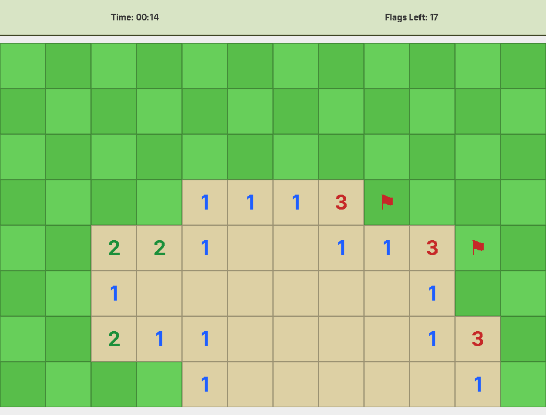

# Minesweeper (Java Swing)

A desktop Minesweeper game written in Java using Swing. It has three difficulty levels, a timer, flagging, and a safe first click.

This was my final project for AP Computer Science A.



## Features
- Three difficulty presets: Easy (12×8), Medium (18×12), Hard (27×18)
- Safe first click (the first revealed square is never a mine)
- Left-click to reveal, right-click to toggle a flag
- Timer and remaining-flag counter
- Win/lose detection with an end-of-game animation and restart option
- Resizable window that keeps the board's squares square

## Prerequisites
- JDK 17 or newer (`javac` and `java` on your `PATH`)

## Build & Run
From the repository root:

```bash
javac src/*.java -d bin/
java -cp bin/ Window
```

A difficulty picker opens; choose Easy, Medium, or Hard to start a game.

To run from an IDE, open the project as a Java project with `src/` as the source folder and run the `Window` class.

## Controls
- Left-click: reveal a square
- Right-click: place or remove a flag
- Goal: reveal every square that isn't a mine

## Project Structure
- `src/Window.java` — Swing UI and entry point (`main`)
- `src/Board.java` — game logic and board state
- `src/Square.java` — a single cell
- `bin/` — compiled classes (generated by the build step above, not checked in)

## Design Notes
- The board is a 2D array of `Square` objects.
- `Board` handles mine placement, neighbor counts, and reveal/flag operations.
- `Window` handles input, rendering, and the timer/restart flow.

## Class Diagram


## Possible Improvements
- Custom difficulty (board size and mine count)
- Keyboard controls and a high-contrast theme
- Saved high scores

## License
Released under the [MIT License](LICENSE). Created by Anthony Mokhov.
